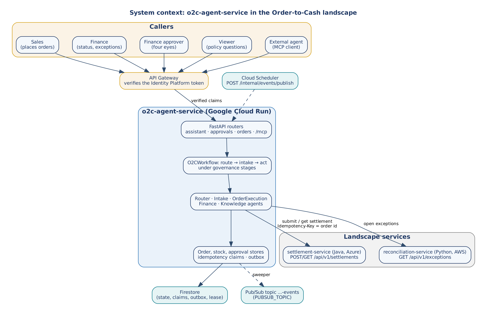
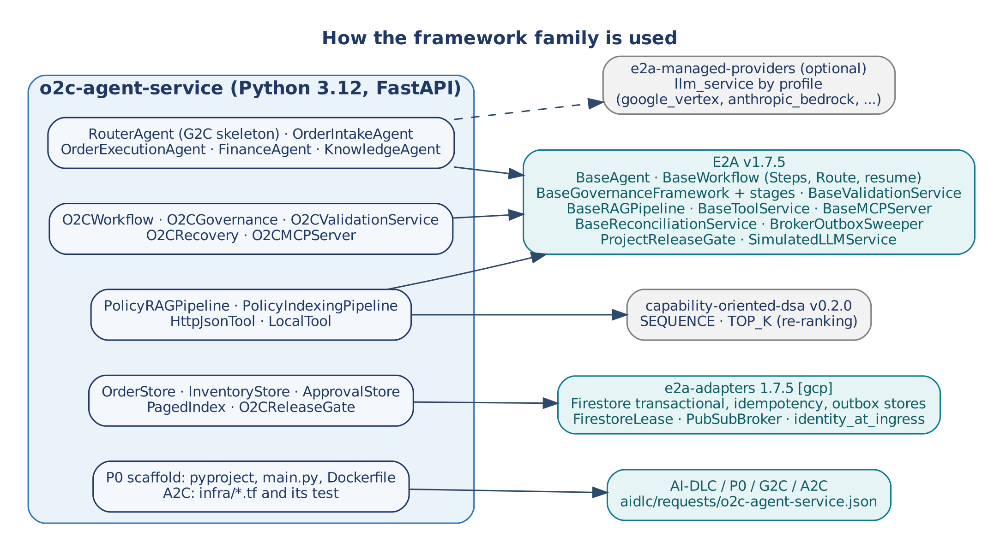
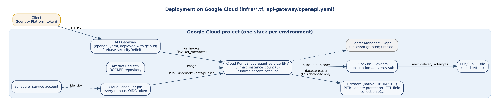
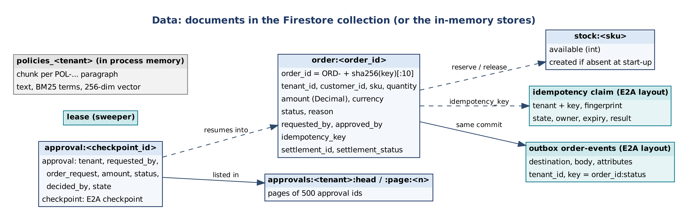
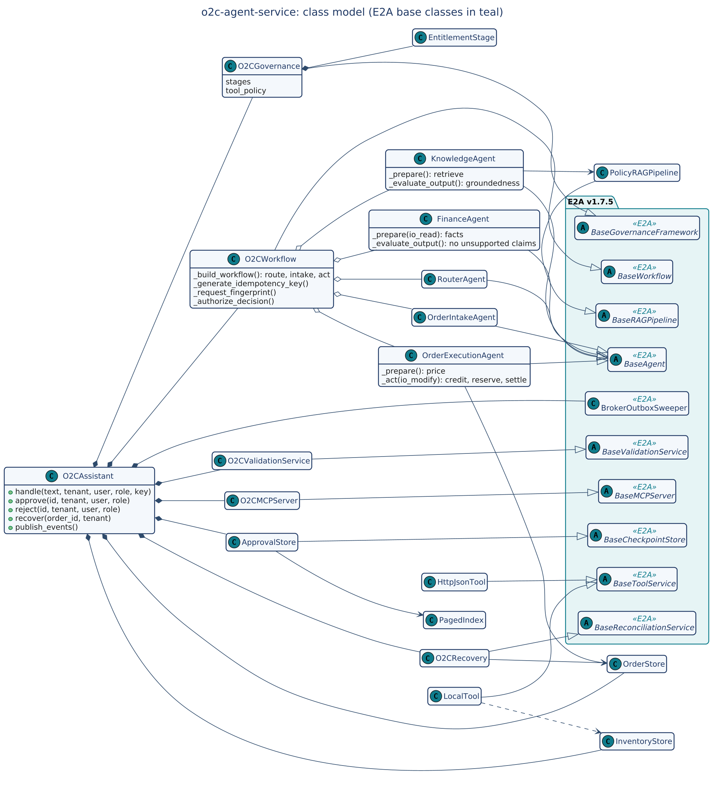
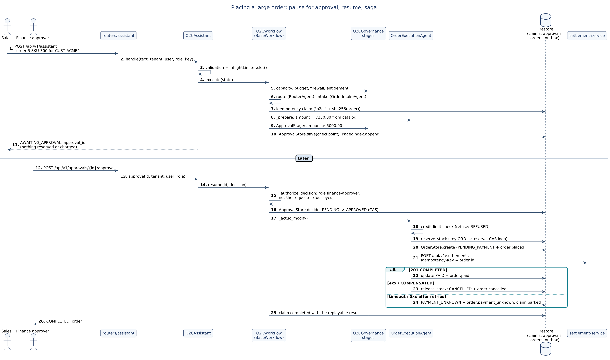
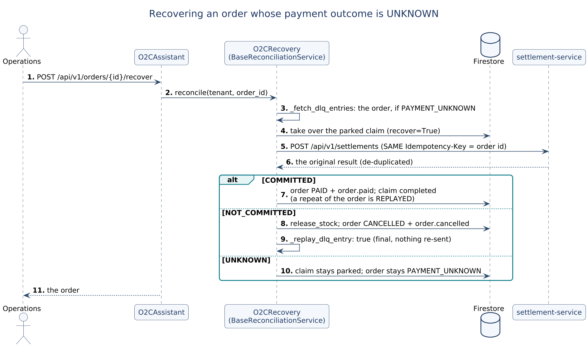
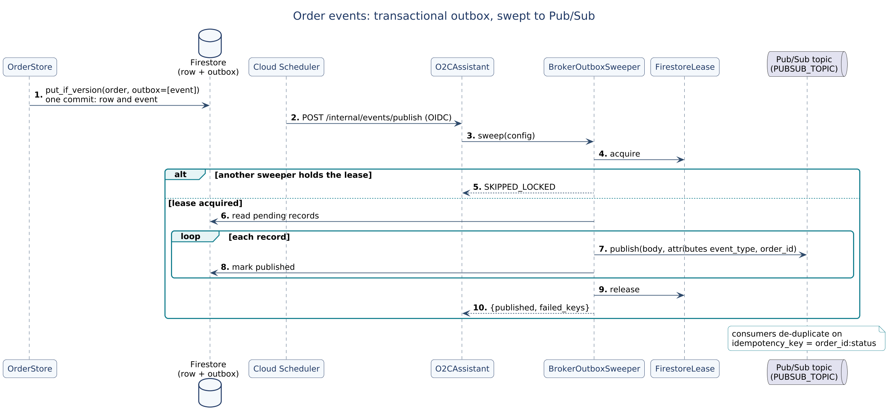
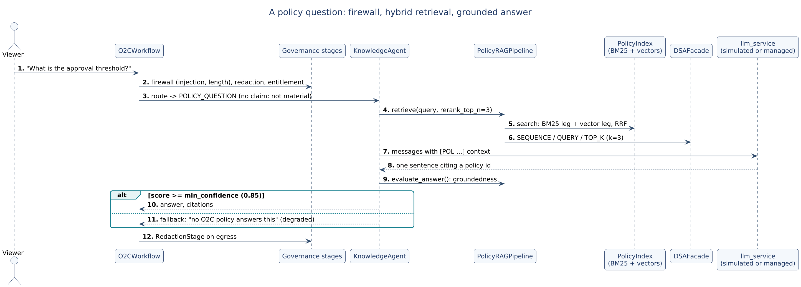
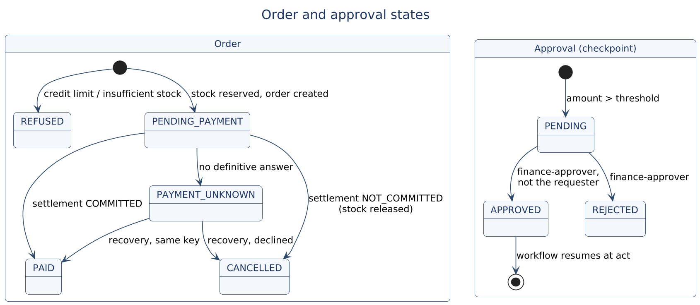

# Order-to-Cash Agentic AI — Design

### High-Level and Low-Level Design

*This document describes `o2c-agent-service`, the natural-language front door of the Order-to-Cash landscape. Sales, finance, approvers and other agents talk to one assistant. Agents understand the request and propose; deterministic controls authorize, execute and confirm every material action (stock, money) through governed tools with typed outcomes, against `settlement-service` and `reconciliation-service`. The document covers the design from the requirements down to class contracts, as the code on `main` implements it. It follows the structure of the E2A, A2C and e2a-managed-providers design documents, and refers to them rather than repeating them.*

| | |
|---|---|
| Project | `order-to-cash-agentic-ai` — service `o2c-agent-service` |
| Document type | Design Document (HLD + LLD) |
| Author | Subham Gupta, Principal Platform Architect |
| Source baseline | `subhamviky/order-to-cash-agentic-ai` `main` at `68a9a32`:<ul><li>**o2c-agent-service:** Python 3.12, FastAPI, about 2,070 lines in 38 modules; `policies/`, `knowledge/`, `evals/`; 14 test modules with 68 test functions.</li><li>**Built on:** **E2A v1.9.1** and **e2a-adapters 1.9.1** `[gcp]` (evaluation, Sections 11 and 13: E2A v1.9); `capability-oriented-dsa` v0.2.0.</li><li>**Infrastructure:** `infra/*.tf` (Google Cloud), `infra/api-gateway/openapi.yaml`, `infra/tests/gcp.tftest.hcl`.</li></ul> |
| Date | 21 November 2026 (evaluation with E2A v1.9; first issue 16 November 2026) |
| Status | Describes the code on `main`. Section 14 lists where the code and the original requirements differ, and the open gaps. |

## 1. Introduction

### 1.1 Purpose

An assistant that places orders moves money. It must never charge a customer twice, never oversell stock, never let a model decide whether money moves, and never act for a role or a tenant it should not. This document is the design reference for the service that does this:
- the requirements (Sections 2 and 3) and principles (Section 4);
- the high-level design: context, how the framework family is used, components, deployment on Google Cloud, integration and identity (Section 5);
- the data design (Section 6);
- the low-level design: modules, class model and contracts (Sections 7 and 8);
- dynamic behaviour (Section 9), consistency and failures (Section 10);
- non-functional design (Section 11), configuration (Section 12), verification (Section 13), and gaps (Section 14).

### 1.2 Audience

| Reader | Read |
|---|---|
| Architects | Sections 2, 4, 5, 10 and 14 |
| Engineers | Sections 6 to 10 and 12 |
| Operations | Sections 5.4, 10, 11 and 12 |
| Reviewers of the frameworks | Section 5.2 and Section 8 |

### 1.3 Status labels

| Label | Meaning |
|---|---|
| **Implemented** | In the code on `main`, with tests that CI runs |
| **Configured** | Implemented, and active only when its setting is given |
| **Gap** | Not done, or done differently from what a requirement intended (Section 14) |

### 1.4 Source of truth and related documents

The code is the source of truth; this document explains it.

| Document | Where | Used for |
|---|---|---|
| Requirements and the first implementation guide | the private hub (`o2c/REQUIREMENTS.md`, `IMPLEMENTATION_GUIDE.md`) | Use cases UC-1 to UC-7, business rules BR-1 to BR-13, acceptance criteria AC-1 to AC-18 |
| E2A Framework — Agentic Core | `e2a-framework/docs/design/core/` | `BaseAgent` lifecycle, `BaseWorkflow` steps and `resume()`, governance stages, RAG ports, tools, idempotency claims, reconciliation, outbox |
| e2a-adapters | `e2a-framework/adapters/` | Firestore stores, `FirestoreLease`, `PubSubBroker`, identity at ingress (`gcp_api_gateway`) |
| A2C, G2C and P0 Framework designs | `a2c-framework/docs/design/` | The scaffold, the router skeleton, the Google Cloud Terraform |
| e2a-managed-providers core design | `e2a-managed-providers/docs/design/core/` | Replacing the simulated model by a managed provider through a profile |
| A2C spec of this service | `o2c-agent-service/docs/a2c/spec.md` | The scaffold's declarations |
| Landscape requirements | hub `settlement/`, `reconciliation/` | The contracts this service consumes |

Product names (Google Cloud, Cloud Run, API Gateway, Firestore, Pub/Sub, Cloud Scheduler, Identity Platform and others) are trademarks of their owners and are used only to describe the design.

## 2. Problem and Requirements

### 2.1 The problem

The original spike was a LangGraph state machine on Amazon Bedrock with OpenSearch. It showed the idea but let a model's text decide outcomes, kept state in one process, and had no approval or idempotency. The requirement is the same front door, rebuilt on the framework family:
- natural language in, governed actions out;
- exactly one charge per order, even when an answer is lost;
- a human decides large orders, and never the person who asked;
- answers about money come from the systems of record, answers about policy from cited policies;
- everything that ships has passed a release gate.

### 2.2 Requirements traced to the design

| Requirement | Design | Section |
|---|---|---|
| BR-1 Entitlements | `EntitlementStage` (before routing and per specialist) and `O2CValidationService._enforce_entitlement_gate` | 5.6, 8.1 |
| BR-2 Firewall and redaction | `FirewallStage` (injection patterns, 500 characters), `RedactionStage` on egress, masks from `governance.yaml` | 5.6, 11 |
| BR-3 Intent | `RouterAgent._evaluate_output` accepts JSON with one of five intents; otherwise UNSUPPORTED | 8.1 |
| BR-4 Intake | `OrderIntakeAgent` with `OrderRequest` (quantity 1–1,000) and the catalog | 8.1 |
| BR-5 Pricing | `Catalog.price` (Decimal, quantized), never the model | 8.1 |
| BR-6 Approval and four eyes | `ApprovalStage`, `ApprovalStore` (checkpoints), `O2CWorkflow._authorize_decision` | 9.1 |
| BR-7 Order saga | `OrderExecutionAgent._act` and `advance_order`: credit → order RESERVING → reserve → settlement; `apply_settlement_result` releases the stock; resumable from any status | 9.1, 9.2 |
| BR-8 Exactly one charge | E2A idempotency claim in `BaseWorkflow.execute`; settlement `Idempotency-Key` = order id | 10 |
| BR-9 Typed outcomes | `HttpJsonTool` maps HTTP to COMMITTED / NOT_COMMITTED / UNKNOWN; `O2CRecovery` | 9.2, 10 |
| BR-10 Tool allow-list | `O2CGovernance.tool_policy`, applied by `io_read` / `io_modify` | 8.1 |
| BR-11 Finance answers | `FinanceAgent._evaluate_output` rejects unsupported identifiers, amounts and statuses | 8.1 |
| BR-12 Policy answers | `KnowledgeAgent` with `evaluate_answer()` (groundedness ≥ 0.85) and citations | 9.4 |
| BR-13 Budgets | `CapacityStage` with `InflightLimiter(20)`, `TokenBudgetStage` (4,000) | 11 |

### 2.3 What changed since the requirements were written

The requirements describe v1. Since then:
- **State is durable and shared.** Orders, stock, approvals and claims moved to Firestore through e2a-adapters, so Cloud Run runs up to three instances instead of one (backlog item 1).
- **Order events** are committed with each order change (transactional outbox) and published to Pub/Sub by a sweeper that Cloud Scheduler calls (backlog item 1).
- **Authentication** is identity at ingress: API Gateway verifies the Identity Platform token and the service reads only the verified claims (backlog item 2).
- **Managed providers.** The e2a-managed-providers CI runs this service's suite and a landscape run on every provider profile (backlog item 3, without a deployment change).

Sections 5 to 13 describe this current state; Section 14 records the remaining differences.

## 3. Use Cases and Non-goals

### 3.1 Actors

| Actor | Role in `governance.yaml` | May reach |
|---|---|---|
| Sales | `sales` | Router, OrderExecution, Finance, Knowledge |
| Finance | `finance` | Router, Finance, Knowledge |
| Finance approver | `finance-approver` | Router, Finance, Knowledge; decides approvals |
| Viewer | `viewer` | Router, Knowledge |
| External agent | any role, through `/mcp` | `check_stock`, `get_order` (read-only) |
| Operations | a Cloud Run invoker | `POST /api/v1/orders/{id}/recover` |
| Cloud Scheduler | its own service account | `POST /internal/events/publish` |

### 3.2 Use-case catalogue

| ID | Use case | Outcome | Status |
|---|---|---|---|
| UC-1 | Place an order in plain language | Priced, credit-checked, stock reserved, paid; or refused or cancelled with the reason | Implemented |
| UC-2 | Approve or reject a large order | The paused order resumes and executes, or ends with no effect | Implemented |
| UC-3 | Ask for an order's payment status | The order from this service and the settlement status from settlement-service | Implemented |
| UC-4 | Ask which payments need attention | Open reconciliation exceptions with the proposed action | Implemented |
| UC-5 | Ask a policy question | A one-sentence answer citing the policy, or a decline | Implemented |
| UC-6 | Recover an order whose payment outcome is unknown | The original settlement result, fetched with the same key; never a second charge | Implemented (on request) |
| UC-7 | Use O2C tools from another agent | `check_stock` and `get_order` over MCP, scoped to the caller's tenant | Implemented |
| UC-8 | Announce order changes | `order.placed`, `order.paid`, `order.payment_unknown`, `order.cancelled`, `order.refused` on Pub/Sub | Implemented |

### 3.3 Non-goals

- Invoices, credit notes and refunds as tools (refunds are settlement-service adjustments, driven by reconciliation).
- A model deciding anything material: the execution agent has no model step.
- Real embeddings and a hosted vector store: the policy corpus is three small documents.
- A deployment pipeline: the image is built and smoke-tested in CI, not pushed.

## 4. Design Principles and Invariants

### 4.1 Principles

| # | Principle | Where it shows |
|---|---|---|
| P-1 | **Agents propose; controls decide.** A model classifies, extracts and phrases. Prices, limits, stock, approval and money are decided by code and by the systems of record. | `OrderExecutionAgent` has no model step; `_evaluate_output` checks every model answer |
| P-2 | **Typed outcomes, never text.** Only a tool's `outcome` decides an order's status. | `HttpJsonTool`, `apply_settlement_result` |
| P-3 | **One key per effect.** Every material call has its own idempotency key, derived from the order. | `ORD-…`, `ORD-…:reserve`, `ORD-…:release` |
| P-4 | **Fail closed.** Unknown role, unverified caller, unsupported intent, ungrounded answer: refuse or decline. | Governance stages, identity at ingress, fallbacks |
| P-5 | **Policy as data.** Roles, tools, thresholds, firewall patterns, masks and budgets are in `governance.yaml`, rebuilt on every request. | `O2CGovernance.stages` |
| P-6 | **Inherit, don't override, the public entry points.** The service implements hooks only; E2A conformance (strict) checks it. | Every class in Section 8 |
| P-7 | **Same code, any backend.** Memory or Firestore by one setting, the same tests on both. | `services/state.py` |

### 4.2 Invariants

| # | Invariant | Enforced by |
|---|---|---|
| I-1 | An order is executed at most once per idempotency key; the same key with a different order is a CONFLICT. | E2A claim with `_request_fingerprint` (business content only) |
| I-2 | A customer is charged at most once per order. | settlement `Idempotency-Key` = order id, also on recovery |
| I-3 | Stock never goes below zero, and is never reserved or released twice for one order. | `InventoryStore`: compare-and-set loops; a keyed change records its key in the same write and is not repeated |
| I-4 | A declined payment never keeps stock. | `apply_settlement_result` → `release_stock` |
| I-5 | Nothing is reserved or charged before a required approval. | `ApprovalStage` runs after `_prepare` and before `_act` |
| I-6 | An approval is decided once, by a finance approver who is not the requester. | `ApprovalStore.decide` (CAS on PENDING), `_authorize_decision` |
| I-7 | Every committed order change has exactly one pending event, and no event announces an uncommitted change. | `put_if_version(..., outbox=[event])` in one commit |
| I-8 | A caller only sees and acts on its own tenant's orders, approvals and tools. | `Caller` from verified claims; stores filter by tenant; MCP adds the caller's tenant |

## 5. High-Level Design

### 5.1 System context



### 5.2 How the framework family is used



| Framework | Used for | Where |
|---|---|---|
| **AI-DLC / P0** | Poetry project, FastAPI `main.py`, Dockerfile, first test, generated from one request file | `aidlc/requests/o2c-agent-service.json`, `aidlc-scaffold.yml` |
| **G2C** | `RouterAgent` skeleton on the installed E2A `BaseAgent`; hooks implemented by hand | `agents/router_agent.py` |
| **A2C** | Spec, Google Cloud Terraform (Cloud Run, Pub/Sub with dead-letter topic, Secret Manager) and its test | `docs/a2c/spec.md`, `infra/main.tf`, `infra/tests/` |
| **E2A v1.8.0** | <ul><li>`BaseAgent` ×5, `BaseWorkflow` (`Steps`, `Step`, `Route`, `resume()`);</li><li>`BaseGovernanceFramework` with stages, `BaseValidationService`;</li><li>`BaseRAGPipeline`, `BaseIndexingPipeline`, `BaseEmbeddingModel`, `BaseVectorIndex`, `RAGPipeline`;</li><li>`RestToolService`, `BaseToolService`, `BaseMCPServer`, `ModifyAccess`;</li><li>`BaseReconciliationService`, `BaseCheckpointStore`, `BrokerOutboxSweeper`;</li><li>`ProjectReleaseGate`, `SimulatedLLMService`, in-memory reference adapters.</li></ul> | everywhere |
| **e2a-adapters 1.8.0** `[gcp]` | `workload_credentials` (a Google ID token exchanged for Entra, SI-01), `FirestoreTransactionalStore`, `FirestoreIdempotencyStore`, `FirestoreOutboxStore`, `FirestoreLease`, `PubSubBroker`, `identity_at_ingress` (`gcp_api_gateway`, Identity Platform claim preset) | `services/state.py`, `routers/identity.py` |
| **e2a-managed-providers** | Optional. A profile replaces `build_o2c_llm()` with a managed `llm_service`. The provider repository's CI runs this suite and a landscape run on every profile. | `run_project_suites.sh`, `run_landscape.py` there |
| **DSA** | Governed `TOP_K` for re-ranking retrieved policies | `rag/policy_rag.py` |

### 5.3 Logical architecture

| Component | Responsibility |
|---|---|
| `routers/assistant.py`, `routers/identity.py` | HTTP surface; the `Caller` (tenant, user, role) from verified claims or, locally, headers; error mapping 400/403/404/503 |
| `O2CAssistant` | Composition root; `handle`, `approve`, `reject`, `recover`, `publish_events` |
| `O2CWorkflow` | Steps route → intake → act; the order's key, fingerprint and who may decide |
| `RouterAgent`, `OrderIntakeAgent` | Intent; extraction of `{customer_id, sku, quantity}` (a proposal) |
| `OrderExecutionAgent` | The deterministic order saga |
| `FinanceAgent` | Order and exception facts from the systems of record, phrased and checked |
| `KnowledgeAgent`, `PolicyRAGPipeline`, `PolicyIndex` | Hybrid retrieval, grounded and cited answer |
| `O2CGovernance`, `EntitlementStage`, `O2CValidationService` | Stages, tool allow-list, schema and entitlement checks |
| `HttpJsonTool`, `LocalTool`, `O2CMCPServer` | Governed tools; the read-only tools over MCP |
| `OrderStore`, `InventoryStore`, `ApprovalStore`, `PagedIndex` | State on an E2A transactional store, with the outbox |
| `O2CRecovery` | Unfinished orders (RESERVING, PENDING_PAYMENT, PAYMENT_UNKNOWN), finished with the same keys |
| `BrokerOutboxSweeper` (E2A) | Publishes pending order events under a lease |
| `O2CReleaseGate` | AI-DLC release gate: RAG golden set, red-team probes, and since E2A v1.9 trajectory cases scored by `e2a.evals` (`_run_case` runs the assistant and returns the workflow's state) |

### 5.4 Deployment on Google Cloud



| File | Resources |
|---|---|
| `main.tf` | <ul><li>Runtime service account.</li><li>Pub/Sub topic `…-events`, dead-letter topic `…-dlq`, subscription `…-events-sub` with `max_delivery_attempts`.</li><li>Secret Manager secret `…-app` with accessor for the runtime account (value set out of band).</li><li>Cloud Run v2 service: ingress all, 0 to `max_instance_count` instances, environment from the other files.</li></ul> |
| `o2c.tf` | Downstream URLs; `invoker_members` with a validation that refuses `allUsers` and `allAuthenticatedUsers` ("the O2C assistant moves money: it is never public"); Artifact Registry (Docker); `run.invoker` per member |
| `firestore.tf` | Firestore native database, optimistic concurrency, point-in-time recovery, delete protection; TTL field `ttl`; `datastore.user` conditioned on this database only; `max_instance_count` default 3 |
| `events.tf` | `pubsub.publisher` on the events topic; scheduler service account with `run.invoker`; Cloud Scheduler job every minute calling `/internal/events/publish` with an OIDC token, no retry (the next run picks up what is pending) |
| `recovery.tf` | A second Cloud Scheduler job, every five minutes (`recovery_schedule`), calling `/internal/orders/recover` with the scheduler's OIDC token; `O2C_RECOVERY_AFTER_SECONDS` (600) |
| `identity.tf` | `E2A_IDENTITY_SOURCE=gcp_api_gateway` (default) and the trusted issuers as environment |
| `api-gateway/openapi.yaml` | API Gateway config (Swagger 2.0): `x-google-backend` to the Cloud Run URL, Firebase / Identity Platform security definition; routes for assistant, approvals, orders, recover, `/mcp`, `/health`. Deployed with `gcloud`; its service account is one of the `invoker_members`. |

### 5.5 Integration and contracts

| Interface | Direction | Contract |
|---|---|---|
| `POST /api/v1/settlements` | O2C → settlement-service | `{payerAccount, payeeAccount, amount, currency}`, headers `X-Tenant-Id`, `Idempotency-Key` = order id. Success: `201` with status COMPLETED. Definitive: `201` (COMPENSATED), `400`, `404`, `422`. `409` (the same key still in progress at settlement-service), `5xx` or no answer: UNKNOWN. |
| `GET /api/v1/settlements/{id}` | O2C → settlement-service | Settlement view (status) for UC-3 |
| `GET /service/v1/exceptions?status=OPEN` (the service route, SI-01) | O2C → reconciliation-service | Cases with `line_id`, `kind`, `detail`, `proposal.action` |
| Order events | O2C → Pub/Sub topic | Body: `event_type` plus `order_id`, `tenant_id`, `customer_id`, `sku`, `quantity`, `amount`, `currency`, `status`, `settlement_id`, `reason`. Attributes `event_type`, `order_id`. Idempotency key `order_id:status`. |
| MCP | external agent → O2C | JSON-RPC 2.0 `tools/list`, `tools/call` for `check_stock`, `get_order` |

The tests use in-process fakes of both downstream services (`release/fakes.py`). The `landscape-demo` workflow runs the real settlement-service (Java), reconciliation-service (on a moto server) and this service, and passes a 15-step scenario.

### 5.6 Identity and security

- **At ingress.** API Gateway verifies the caller's Identity Platform token and passes the verified claims in `X-Apigateway-Api-Userinfo`. `identity_at_ingress` maps them (preset `identity_platform`: tenant = `firebase.tenant`, roles = `roles`) and checks trusted issuers.
  - No verified claims: `401`.
  - `X-Tenant-Id` naming another tenant, or `X-User-Role` naming a role the credentials do not carry: `403`.
  - `X-User-Role` chooses which of the caller's roles to act in; without it, the first role.
  - Without `E2A_IDENTITY_SOURCE` (tests, local, landscape demo) the three headers are taken as given.
- **Reaching Cloud Run.** Only `invoker_members` (the gateway's account, operators) and the scheduler's account hold `run.invoker`; `allUsers` is refused by validation.
- **Inside.** Entitlements per agent (ABAC); tool allow-list per agent; firewall before any model call; masks for card numbers and e-mail addresses on ingress and egress; MCP calls always carry the caller's tenant.
- **Downstream** (hub design note SI-01).
  - **What each call carries:** calls to settlement-service and to reconciliation's service route send `Authorization: Bearer` with an Entra token, along with `X-Tenant-Id`.
  - **How the token is made:** the Cloud Run service account's Google ID token is exchanged for an Entra token for each target. `e2a_adapters.workload` is bound as `config['credential_provider']`, and `HttpJsonTool` sends its headers.
  - **No secret:** the caller app's federated credential trusts the service account's unique id.
  - **Grants:** submit and read on settlement, and read on reconciliation, for its tenants (`landscape-identity/` in financial-settlement-platform). Local tools get no token.
- **Secrets.** None in code or Terraform. Firestore and Pub/Sub use the runtime service account.

### 5.7 Model access

- `build_o2c_llm()` returns E2A's `SimulatedLLMService` with one rule per agent, selected by the agent's system prompt. Each rule behaves like a plausible model; its output is always checked by the agent's `_evaluate_output`.
- Agents reach the model only through `config['llm_service']`, so a managed provider replaces it through an e2a-managed-providers profile without code changes.
- `OrderExecutionAgent._build_messages` returns `None`: placing an order has no model step.
- Usage (calls, tokens, cost) is at `GET /api/v1/usage`.

## 6. Data Design



All state is on two E2A ports chosen by `O2C_STATE_BACKEND`: a `BaseTransactionalStore` (with its outbox) and a `BaseIdempotencyStore`. `memory` uses the reference adapters; `firestore` uses one Firestore collection (`o2c` by default) shared by every instance.

| Document | Key | Content and rules |
|---|---|---|
| Order | `order:<order_id>` | `Order`: tenant, customer, sku, quantity, amount, currency, status, requester, approver, idempotency key, settlement id and status, reason. `create` is insert-once; `update` is a compare-and-set that fails on a concurrent change. |
| Stock | `stock:<sku>` | `{available, applied}`. `applied` holds the keys (`ORD-…:reserve`, `ORD-…:release`) of changes made for orders not yet final, written in the same compare-and-set as the change; dropped when the order is final. Created if absent at start-up, so a restart never resets reserved stock. |
| Approval | `approval:<checkpoint_id>` | `{approval, checkpoint}`: the `Approval` (requester, order request, amount, key, status, decider, dehydrated state) and E2A's checkpoint |
| Approval index | `approvals:<tenant>:head`, `…:page:<n>` | `PagedIndex`: pages of 500 ids, compare-and-set appends; keeps every document below Firestore's size limit |
| Idempotency claim | E2A layout | One per tenant and key: fingerprint, state (IN_PROGRESS, SUCCEEDED, UNKNOWN …), owner, expiry, replayable result |
| Outbox record | E2A layout, `order-events` | Destination, body, attributes, tenant, idempotency key; pending until the sweeper publishes it |
| Lease | E2A layout | One sweeper at a time |
| Open orders | `open-orders` | `{"<tenant>/<order_id>": since}`: every order not yet final. Listed before the order is first written, removed after it is final (compare-and-set), so a crash leaves it listed, never lost. Holds only unfinished orders, so it stays small. |
| Policy index | `policies_<tenant>` (process memory) | One chunk per `POL-…` paragraph: text, BM25 terms, 256-dimension hashed vector; rebuilt from `knowledge/` at start-up |

**Reference data** is in `policies/catalog.yaml` (tenant `acme`, EUR, receivable account ACC-3000; customers CUST-ACME, CUST-GLOBEX, CUST-HOLD with payer accounts and credit limits; products SKU-100, SKU-200, SKU-300 with price and initial stock).

**Identifiers.** Order id = `ORD-` + the first ten hex characters of sha256(idempotency key), upper case. The idempotency key is the client's `Idempotency-Key`, or `o2c-` + sha256(tenant, user, order request) for orders.

## 7. Low-Level Design — Module Structure and Class Model

### 7.1 Modules

| Package | Modules (lines) |
|---|---|
| `agents` | `router_agent` (51), `order_intake_agent` (53), `order_execution_agent` (91), `finance_agent` (77), `knowledge_agent` (42) |
| `workflow` | `o2c_workflow` |
| `services` | `assistant`, `governance` (89), `validation` (44), `catalog` (40), `stores` (130), `paged_index` (44), `state` (65), `events` (39), `recovery` (50), `llm` (75) |
| `tools` | `services` (96: `HttpJsonTool`, `LocalTool`, tool factories), `local` (33), `mcp_server` (22) |
| `rag` | `policy_rag` (177) |
| `routers` | `assistant` (83), `identity` (54) |
| `release` | `gate` (70), `fakes` (80) |
| `models` | `schemas`: `AssistantRequest`, `OrderRequest`, `Order`, `Approval`, `AssistantResponse` |
| root | `main.py`: `build_app`, the `app` with the simulated model and the downstream URLs |

### 7.2 Class model



## 8. Low-Level Design — Class Contracts

### 8.1 Agents, workflow and governance

| Class (base) | Hooks implemented | Contract |
|---|---|---|
| `O2CWorkflow` (`BaseWorkflow`) | `_build_workflow`, `_generate_idempotency_key`, `_requires_idempotency_claim`, `_request_fingerprint`, `_authorize_decision`, `_handle_error` | <ul><li>Steps: `route` (stops on UNSUPPORTED); `intake` only for PLACE_ORDER (stops when incomplete); `act` routed by intent, material.</li><li>A claim only for PLACE_ORDER. Fingerprint = tenant, user and order request.</li><li>Decisions: role `finance-approver` and, with `four_eyes`, not the requester; otherwise `ResumeRefused` code `DECIDER_REFUSED`.</li></ul> |
| `RouterAgent` (`BaseAgent`) | `_build_messages`, `_apply_policy`, `_evaluate_output`, `_fallback`, `_handle_error` | JSON `{"intent"}` with one of PLACE_ORDER, ORDER_STATUS, PAYMENT_EXCEPTIONS, POLICY_QUESTION, UNSUPPORTED scores 1.0; anything else 0.0; fallback and errors → UNSUPPORTED |
| `OrderIntakeAgent` | `_build_messages`, `_evaluate_output`, `_fallback`, `_handle_error` | Accepted only when it parses, validates as `OrderRequest` and names a known customer and SKU; otherwise `missing` is set and nothing happens |
| `OrderExecutionAgent` | `_prepare`, `_build_messages` (None), `_act` | `_prepare` prices from the catalog. `_act`: credit limit (REFUSED, NOT_COMMITTED) → create the order RESERVING (no event) → `advance_order`. `advance_order` continues from the order's status: RESERVING → `reserve_stock` (`ORD-…:reserve`) → PENDING_PAYMENT (`order.placed`) or REFUSED; PENDING_PAYMENT or PAYMENT_UNKNOWN → `submit_settlement` (key = order id) → `apply_settlement_result`; final → forget the stock keys. Returns the typed outcomes; E2A confirms UNKNOWN > NOT_COMMITTED > COMMITTED. |
| `FinanceAgent` | `_apply_policy`, `_prepare(io_read)`, `_build_messages`, `_evaluate_output`, `_fallback` | Facts read before the model (`get_order`, `get_settlement`, `open_exceptions`). Any `ORD-…`, UUID, amount or upper-case status in the answer that is not in the facts → 0.0; the fallback is the facts. |
| `KnowledgeAgent` | `_prepare`, `_build_messages`, `_evaluate_output`, `_fallback` | Retrieves three chunks; score = `evaluate_answer()`; citations = cited ids that were retrieved; fallback declines |
| `O2CGovernance` (`BaseGovernanceFramework`) | `stages`, `tool_policy` | Stages in order: Capacity, TokenBudget, Firewall, Entitlement, Sandbox, Approval (amount > threshold), Redaction. Rebuilt from the policy on every request. |
| `EntitlementStage` (`IngressStage`) | `check` | The caller's role must be listed for the agent serving the intent (RouterAgent before routing); `EntitlementRefusal` code ENTITLEMENT |
| `O2CValidationService` (`BaseValidationService`) | validators, `_enforce_entitlement_gate` | Tenant matches `^[a-z][a-z0-9-]{1,31}$`; user, role and text present; then the role check |

### 8.2 Tools, state and recovery

| Class (base) | Contract |
|---|---|
| `HttpJsonTool` (`RestToolService`) | `_send_request`: `X-Tenant-Id` and `Idempotency-Key` headers; `5xx` raises so the resilience policy may retry a replay-safe call; otherwise `{status, physical_success, outcome, body}` with the outcome from `success` and `definitive` |
| `LocalTool` (`BaseToolService`) | A function of this service behind the same contract; the tenant from the payload or the request |
| `local_tools` | `check_stock` (read), `reserve_stock` and `release_stock` (material), `get_order` (read, tenant-scoped) |
| `O2CMCPServer` (`BaseMCPServer`) | Registers `check_stock` and `get_order` with `wrap_api_as_tool`; `_call_tool` overwrites the tenant with the caller's |
| `OrderStore` | `create` (insert-once), `update` (CAS, raises on conflict), `get` (tenant-filtered); events in the same commit when the store has an outbox |
| `InventoryStore` | `available`, `applied`; `reserve(sku, qty, key)` and `release(sku, qty, key)` as compare-and-set loops, a keyed change made at most once; `forget(sku, *keys)` |
| `ApprovalStore` (`BaseCheckpointStore`) | `save` (insert-once, then index), `load` (tenant-checked, with status), `decide` (PENDING → APPROVED or REJECTED, one CAS), `get`, `list` |
| `PagedIndex` | `append` (CAS; a full page opens the next), iteration without duplicates |
| `O2CRecovery` (`BaseReconciliationService`) | `_fetch_dlq_entries`: the order if RESERVING, PENDING_PAYMENT or PAYMENT_UNKNOWN. The inherited `reconcile()` takes over its claim only when the request is finished or its lease expired. `_confirm_physical_outcome`: `advance_order` with the same keys, then the outcome of the order's status, and the replayable result. `_replay_dlq_entry`: true (CANCELLED or REFUSED is final). |
| `PolicyRAGPipeline` (`BaseRAGPipeline`) | `_rerank`: DSA `SEQUENCE`/`QUERY`/`TOP_K`. `_evaluate_answer`: share of sentences that cite a retrieved policy and whose content words (≥ 60 %) appear in it. |
| `PolicyIndexingPipeline` (`BaseIndexingPipeline`) | `_chunk_documents`: one chunk per paragraph with a `POL-…` id; a document without one fails the ingest (start-up stops) |
| `PolicyIndex` (`BaseVectorIndex`) | Per-tenant namespaces; upsert by chunk id; `search` = BM25 leg and cosine leg fused by reciprocal rank (k = 60), only chunks sharing a term |

### 8.3 HTTP API

| Method and path | Responses |
|---|---|
| `POST /api/v1/assistant` `{text}`, optional `Idempotency-Key` | `200` `AssistantResponse` with `status` COMPLETED, AWAITING_APPROVAL, NEEDS_CLARIFICATION, REFUSED, REPLAYED, CONFLICT, IN_PROGRESS, RECOVERY_REQUIRED, FAILED_FINAL or FAILED · `400` · `401`/`403` · `503` (admission control) |
| `GET /api/v1/approvals?status=` | The tenant's approvals |
| `POST /api/v1/approvals/{id}/approve` · `/reject` | `200` the resumed order or the rejection · `403` wrong role, own order or already decided · `404` |
| `GET /api/v1/orders/{id}` | `200` · `404` |
| `POST /api/v1/orders/{id}/recover` | `200` the order after recovery · `404` |
| `GET /api/v1/usage` | Simulated model calls, tokens and cost |
| `POST /mcp` | JSON-RPC 2.0 |
| `POST /internal/events/publish` | `{status, published, failed_keys}`; SKIPPED_LOCKED when another sweeper holds the lease |
| `POST /internal/orders/recover` | `{checked, finished, still_open, removed}`: the scheduled sweep of unfinished orders |
| `GET /health` | `{status: UP}` |

## 9. Dynamic Behaviour

### 9.1 Placing an order, with approval



A small order runs the same path without the pause: `ApprovalStage` passes and `_act` runs in the first request. A rejection decides the checkpoint REJECTED and ends: nothing was reserved or charged.

### 9.2 Recovering an unfinished order



### 9.3 Order events



### 9.4 A policy question



### 9.5 States



## 10. Consistency, Concurrency and Failures

| Situation | Behaviour |
|---|---|
| The same order sent twice (same key, same content) | The second request finds the completed claim: REPLAYED with the stored result, no tool call |
| One key, two different orders | Fingerprint mismatch: CONFLICT |
| Two instances take the same order at once | One wins the claim; the other gets IN_PROGRESS |
| Two orders race for the last stock | `reserve` is a CAS loop; the loser re-reads and is refused if insufficient |
| Two approvers decide at once | `decide` is a CAS on PENDING; the second gets `403` |
| settlement-service answers `5xx` | The resilience policy retries with the same key (`retries` 2), then UNKNOWN |
| settlement-service times out, the answer is lost, or it answers `409` (the key still in progress there) | UNKNOWN: order PAYMENT_UNKNOWN (degraded answer), stock kept, claim parked (RECOVERY_REQUIRED for a repeat) until `recover` |
| The process dies inside the saga (after the order is recorded) | The order stays RESERVING or PENDING_PAYMENT; once the claim's lease expires a repeat answers RECOVERY_REQUIRED with the order id, and `recover` finishes it with the same keys: reserved once, released once, charged once |
| The process dies before the order is recorded (after the claim) | Nothing has moved. A repeat answers RECOVERY_REQUIRED and there is no order to recover (G-12) |
| settlement-service declines (`4xx`, COMPENSATED) | NOT_COMMITTED: stock released under `ORD-…:release`, order CANCELLED |
| reconciliation-service or the settlement read is down | The finance facts say so; nothing is guessed |
| A concurrent update of an order | `OrderStore.update` raises; the workflow records FAILED |
| The process dies after the order commit | The event is already in the outbox and is published by the next sweep |
| Two sweeps at once | The lease admits one; the other returns SKIPPED_LOCKED |
| Pub/Sub delivers an event twice | Consumers de-duplicate on `order_id:status` |
| More than 20 requests in flight | `CapacityRefusal` → `503` |
| Model output invalid or ungrounded | The agent's fallback (UNSUPPORTED, clarification, facts, decline), marked degraded |

## 11. Non-Functional Design

| NFR | Mechanism | Evidence |
|---|---|---|
| Idempotency, one charge | E2A claim; order id as settlement key; recovery with the same key | `test_orders.py` (AC-3, AC-4, AC-8) |
| Consistency | CAS stores; compensation; outbox in the same commit | `test_orders.py`, `test_shared_state.py`, `test_order_events.py` |
| Scale-out | Firestore state shared by up to three instances; paged index; sweeper lease | CI runs the suite again on the Firestore and Pub/Sub emulators with several instances on one database |
| Human oversight | Approval stage, checkpoint, four eyes | AC-7 |
| AI safety | Firewall, redaction on ingress and egress, entitlement, tool allow-list | `test_governance.py`; red-team probes in the release gate |
| AI quality | Router, intake, finance and groundedness checks; RAG golden set (10 cases) and four trajectory cases must score 1.0: an order reserves stock before it submits the settlement and makes at most two tool calls; a policy question and a status question call no material tool; a large order waits for approval before any tool. With `O2C_EVAL_RECORDS`, sampled settled runs are recorded (E2A's recording online evaluator, redacted) | `test_finance_and_knowledge.py`, `test_api_and_release_gate.py`; release gate; landscape demo |
| Capacity | `InflightLimiter(20)`, token budget 4,000 per request | `test_governance.py` |
| Cost | Usage per model call | `/api/v1/usage` |
| Security | Identity at ingress, invokers only from a list, IAM scoped to one database and one topic | `test_identity_at_ingress.py`; `terraform test` |
| Recoverability | Firestore point-in-time recovery and delete protection; dead-letter topic | `firestore.tf`, `main.tf` |
| Delivery | Seven-stage release gate; image build and smoke test | CI |

## 12. Configuration

| Setting | Default | Effect |
|---|---|---|
| `SETTLEMENT_API_URL`, `RECONCILIATION_API_URL` | `http://localhost:8080`, `http://localhost:8001` | Downstream services |
| `SERVICE_ROOT` | the service folder | Where `policies/` and `knowledge/` are read |
| `O2C_STATE_BACKEND` | `memory` | `firestore` for shared state (Terraform sets it) |
| `GOOGLE_CLOUD_PROJECT`, `O2C_FIRESTORE_DATABASE`, `O2C_FIRESTORE_COLLECTION` | —, `(default)`, `o2c` | Firestore |
| `FIRESTORE_EMULATOR_HOST`, `PUBSUB_EMULATOR_HOST` | unset | Emulators |
| `PUBSUB_TOPIC` | `o2c-order-events` | Events topic (Terraform sets the generated topic) |
| `E2A_IDENTITY_SOURCE` | unset (header mode) | `gcp_api_gateway` in Google Cloud: fail closed |
| `E2A_WORKLOAD_IDENTITY=gcp`, `E2A_WORKLOAD_ENTRA_TENANT`, `E2A_WORKLOAD_ENTRA_CLIENT_ID`, `E2A_WORKLOAD_TOKEN_SCOPES` | unset (no token) | This service's own token on calls to settlement and reconciliation (`workload.tf`, SI-01) |
| `E2A_IDENTITY_CLAIM_MAP`, `E2A_IDENTITY_TRUSTED_ISSUERS` | Identity Platform preset; any issuer | Claim mapping |
| `ENVIRONMENT` | — | Label |
| `policies/governance.yaml` | in the repository | Entitlements, tools, approval threshold 5000.00, approver role, four eyes, firewall, masks, capacity |
| `policies/catalog.yaml` | in the repository | Tenant, customers, products, accounts |
| Workflow config (`O2CAssistant`) | `min_confidence` 0.85, `max_latency` 15 s, `timeout` 5 s, `retries` 2 | Agent and tool behaviour |
| Terraform variables | `max_instance_count` 3, `events_publish_schedule` every minute, `invoker_members` [], `identity_source` `gcp_api_gateway` | Deployment |

## 13. Verification and Evidence

| Evidence | What it proves |
|---|---|
| Tests (14 modules, 68 test functions; downstream services as in-process fakes) | AC-1 to AC-14: routing, intake, saga, replay and conflict, credit and stock, compensation, approval and four eyes, unknown outcomes and recovery, finance and knowledge answers, governance, HTTP and MCP. Identity at ingress, order events, paged index, shared state. |
| CI `o2c-ci` tests, second run | The same suite with state in Firestore and events to Pub/Sub (emulators), several instances on one database |
| CI release gate (`O2CReleaseGate`, seven stages) | Secret scan, tests, strict conformance, compile, RAG golden set (10 cases) and four trajectory cases, red-team (injections, PII, entitlements, and two injections that must call no material tool), rollout record. The evidence is labelled `wiring` on the simulated profile |
| CI `terraform` | `fmt`, `validate`, `terraform test` with a mock provider (`gcp.tftest.hcl`) |
| CI `image` | The image builds, starts and answers a policy question |
| `landscape-demo` workflow | 15 steps against the real settlement-service and reconciliation-service (`DEMO PASSED`); every settled run recorded for online evaluation, and `python -m e2a.evals promote` turns the low-scoring, fallback and refused runs into redacted candidate cases (`NEEDS_REVIEW`, never added to the sets automatically); both kept as a workflow artifact |
| e2a-managed-providers CI | This suite and a landscape run on every managed-provider profile |

## 14. Gaps, Deviations and Backlog

| # | Item | Kind | Notes |
|---|---|---|---|
| G-1 | Calls to settlement-service and reconciliation-service carried `X-Tenant-Id` only, with no service credential | Fixed (SI-01) | A Google ID token exchanged for an Entra token per target (Section 5.6); the exception query uses reconciliation's service route. Not yet run against live clouds. |
| G-2 | Unfinished orders were recovered only on request (`POST …/recover`) | Fixed | `recover_stuck()`, every five minutes. Every order listed in `open-orders` for longer than `O2C_RECOVERY_AFTER_SECONDS` (600, past the request's lease) goes through `O2CRecovery`. It never takes over a live claim. Entries whose order is final or missing are removed. |
| G-3 | A crash inside the order saga left an order recovery could not finish: stock reserved with no order (lost), or an order in PENDING_PAYMENT after the money moved. A `409` from settlement-service was taken as a decline. | Fixed | Order recorded RESERVING first; keyed stock changes; `advance_order` shared by the request and recovery; recovery takes RESERVING and PENDING_PAYMENT; `409` is UNKNOWN; RECOVERY_REQUIRED names the order (`test_order_recovery.py`, on memory and on the emulators) |
| G-12 | A crash after the claim but before the order is recorded leaves the claim with nothing to recover | Gap (minor) | Nothing moved. With a derived key the same order by the same user stays RECOVERY_REQUIRED; a recovery path for claims without an order, or a client `Idempotency-Key`, avoids it |
| G-13 | E2A's `BaseWorkflow` settled the claim in `finally`, so a `BaseException` inside a step completed it as SUCCEEDED | Fixed in E2A v1.8.0 | The claim is left IN_PROGRESS for recovery |
| G-4 | The policy index is in process memory, rebuilt at start-up, and only for the catalog's tenant (`acme`) | Limit | Fine for three documents; a hosted index per tenant for a real corpus |
| G-5 | Single tenant reference data: one `catalog.yaml` | Limit | A catalog per tenant (or a product and customer service) for multi-tenant use |
| G-6 | The Secret Manager secret `…-app` from the A2C scaffold is not read by the code | Note | G-1 needed no secret; remove it, or keep it for a future credential |
| G-7 | The subscription `…-events-sub` has no consumer in the landscape | Note | Events are available; settlement or analytics consumers are future work |
| G-8 | `/internal/events/publish`, `/internal/orders/recover` and `/api/v1/usage` have no caller check in the service | Note | Not routed by API Gateway, so only direct Cloud Run invokers (the scheduler, operators) reach them; a role check would make that explicit |
| G-9 | Cloud Run ingress is `INGRESS_TRAFFIC_ALL` | Note | Protected by IAM invokers; internal ingress plus the gateway would narrow it further |
| G-10 | `capability-oriented-dsa` is pinned at v0.2.0; the other projects use v0.3.0 | Note | `TOP_K` is unchanged; align on the next upgrade |
| G-11 | The model is simulated, and embeddings are a hashed bag of words | By design | A managed provider by profile (Section 5.7); real embeddings with the same port |
| D-1 | The requirements state one instance and in-memory state | Done since | Firestore state, up to three instances (Sections 5.4, 6) |
| D-2 | The requirements list authentication and order events as backlog | Done since | Identity at ingress; transactional outbox to Pub/Sub |

## Appendix A — Source files

| Area | Files |
|---|---|
| Service | `o2c-agent-service/src/o2c_agent_service/**`, `policies/governance.yaml`, `policies/catalog.yaml`, `knowledge/*.md`, `evals/golden.json`, `evals/redteam.json`, `pyproject.toml`, `Dockerfile` |
| Infrastructure | `o2c-agent-service/infra/*.tf`, `infra/api-gateway/openapi.yaml`, `infra/tests/gcp.tftest.hcl` |
| Demo | `o2c-agent-service/scripts/landscape_demo.py` |
| CI | `.github/workflows/o2c-ci.yml`, `landscape-demo.yml`, `aidlc-scaffold.yml` |
| Scaffold | `aidlc/requests/`, `o2c-agent-service/docs/a2c/spec.md`, `docs/aidlc/` |

The diagrams are rendered from `diagrams/` (Graphviz `.dot` and PlantUML `.puml`, sharing `common/style.puml`):

```
dot -Tpng -Gdpi=220 diagrams/<name>.dot -o images/<name>.png
java -jar plantuml.jar -tpng -o ../images diagrams/<name>.puml
```
